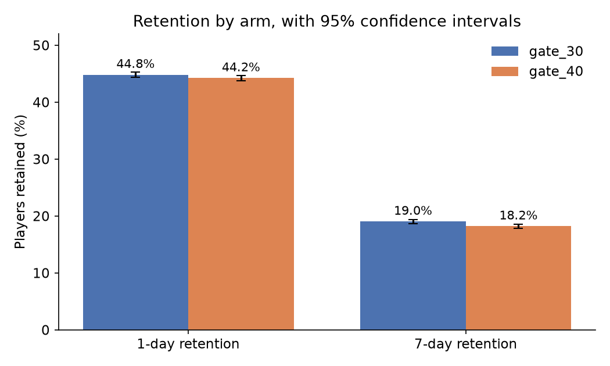
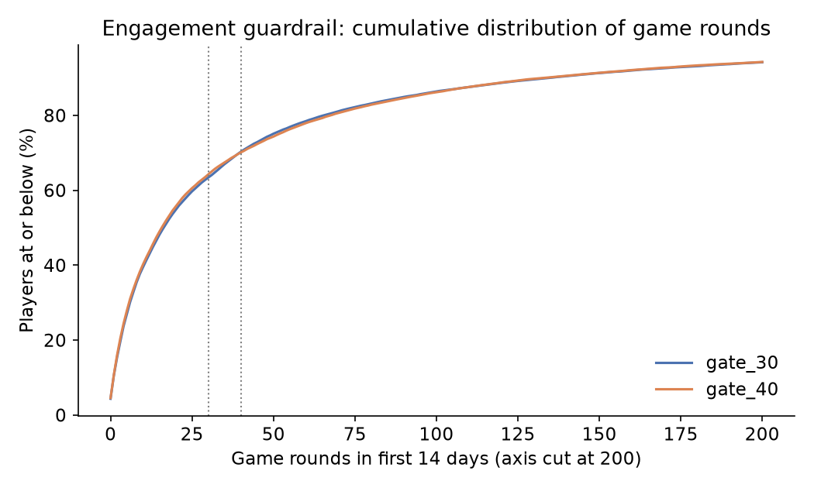

# Does moving the first gate from level 30 to level 40 keep more players?

A small A/B test readout built the way I'd build one at work: raw data goes through dbt models with tests, and a script reads the final table and produces the numbers and charts. The README is written like a take-home answer.

**Short answer: no. Players who hit the gate at level 40 were less likely to come back a week after install (18.2% vs 19.0%). Keep the gate at level 30.**



## The question

Cookie Cats is a mobile puzzle game. At certain levels a "gate" stops the player until they wait or pay. The team tested moving the first gate from level 30 to level 40. Every new player who installed during the test was randomly assigned to one of two groups:

- `gate_30`: the existing design (control)
- `gate_40`: the gate moved later (treatment)

The question for the readout: did the later gate change how many players stick with the game?

## Data

90,189 players, one row each, with their group, the number of game rounds played in the first 14 days, and whether they played again 1 day and 7 days after install.

Source: the public "Mobile Games A/B Testing - Cookie Cats" dataset (Kaggle, originally a DataCamp project). The CSV is not committed here; `scripts/fetch_data.sh` downloads a copy from a public GitHub mirror and checks its SHA-256 so everyone runs on the same file.

## Method

I set the metrics before looking at results. The source doesn't say which metric the team cared about, so these are my choices:

- **Primary metric: 7-day retention.** A gate is meant to pace players, so the risk is losing them over the first week, not the first day.
- **Secondary metric: 1-day retention.**
- **Guardrail: game rounds in the first 14 days.** If retention moved but engagement collapsed, or the reverse, the decision would change.

Checks and tests (all in [`experiment/analyze.py`](experiment/analyze.py), full output in [`experiment/results.md`](experiment/results.md)):

1. **Sample ratio check.** The split should be 50/50. Chi-square test on the group sizes.
2. **Power check.** The smallest difference this sample could reliably detect (alpha 0.05, power 0.80), using the control rate as the baseline. I did not compute "observed power" from the observed effect, since that number tells you nothing new.
3. **Retention.** Difference in proportions (gate_40 minus gate_30), 95% confidence interval, two-sided z-test.
4. **Guardrail.** Game rounds are heavily skewed and one player logged 49,854 rounds (the next highest is 2,961), so a plain mean comparison is not reliable. I report the median, a mean after capping at the 99.9th percentile, and a Mann-Whitney test that doesn't need capping.

## Results

**Sample ratio.** 44,700 players in gate_30 and 45,489 in gate_40 (50.44% in treatment). That small imbalance is statistically significant (p = 0.009). See caveats.

**Power.** At this sample size the test could detect a 0.73 percentage point change in 7-day retention and 0.93 points in 1-day retention. So it was big enough to see the effect that showed up.

**Retention.**

| Metric | gate_30 | gate_40 | Difference | 95% CI | p-value |
|---|---|---|---|---|---|
| 7-day retention (primary) | 19.02% | 18.20% | -0.82 pp (-4.3%) | -1.33 to -0.31 pp | 0.002 |
| 1-day retention | 44.82% | 44.23% | -0.59 pp (-1.3%) | -1.24 to +0.06 pp | 0.074 |

7-day retention dropped by about 0.8 points and the whole confidence interval is below zero. 1-day retention also dropped, but that difference could be noise.

**Guardrail.** Engagement barely moved. Median rounds were 17 vs 16. Capped means were 51.03 vs 50.94 rounds (difference -0.10, CI -1.37 to +1.18). The Mann-Whitney test sat right at the line (p = 0.050), which with a median difference of one round is not a meaningful change. Uncapped, gate_30's mean looks a full round higher, but that's the one extreme player.



The two distributions sit on top of each other. The dotted lines mark 30 and 40 rounds, a rough stand-in for the gate levels.

## Caveats

- **The groups are not exactly 50/50.** With 90k players, a 0.44-point imbalance should almost never happen by chance. It may be harmless (for example, a logging difference), but it can also mean some players were dropped from one group in a way that's tied to the outcome. Before acting on this at a real company I'd ask the engineers how assignment and logging worked. As a stress test, I assumed the worst: every one of the 789 extra gate_40 players was a player who never came back, and removed them. gate_40 7-day retention would still be lower (18.52% vs 19.02%). So the imbalance can't explain the whole drop on its own.
- **Rounds are not levels.** The data counts game rounds, not the highest level reached, so I can't isolate the players who actually reached level 30 or 40. Most players never get that far, which dilutes any effect of the gate.
- **No timestamps and no revenue.** I can't check for novelty effects or whether the earlier gate earned more from purchases.
- **One dataset, one test.** This is a public teaching dataset. I report what it shows; I can't vouch for how it was collected.

## Recommendation

Keep the gate at level 30. The later gate cost about 0.8 points of 7-day retention, and it didn't buy any extra engagement in return. If the team still wants to move the gate, I'd first fix or explain the sample ratio problem and rerun with level-reached data, so the effect can be measured on players who actually hit the gate.

## How it's built

```
seeds/cookie_cats.csv          raw data (downloaded, not committed)
models/staging/                stg_cookie_cats: types and names, nothing else
models/intermediate/           int_player_outcomes: per-player flags
models/marts/                  fct_player_experiment (one row per player)
                               agg_experiment_arms (one row per group)
tests/                         custom tests: no players lost between raw and summary,
                               rounds non-negative, rates between 0 and 1
experiment/analyze.py          reads the mart, writes results.md and charts/
```

Each model has column docs and tests in its `schema.yml` (unique and not-null player ids, accepted group values). `dbt build` runs 23 nodes: 1 seed, 4 models, 18 tests.

The SQL uses dbt's cross-database type macros so the same models run on DuckDB and BigQuery.

## Run it

Local, no account needed (DuckDB):

```bash
python -m venv .venv && source .venv/bin/activate
pip install -r requirements.txt
./scripts/fetch_data.sh
export DBT_PROFILES_DIR=.
dbt build
dbt docs generate      # optional: dbt docs serve to browse the lineage
python experiment/analyze.py
```

BigQuery (free sandbox tier works):

```bash
gcloud auth application-default login
export GCP_PROJECT=your-project-id
dbt build --target bq
```

Status: the DuckDB target is tested end to end. The BigQuery target is configured but has not been run yet. The analysis script reads the DuckDB file.
